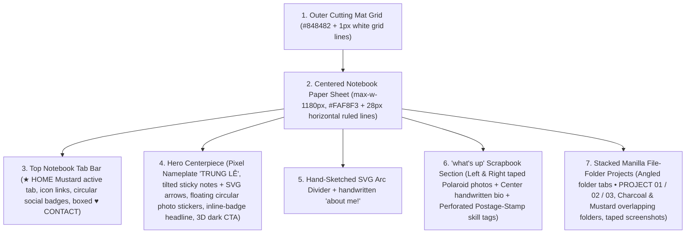

# DESIGN.md — Tactile Analog-Pixel Notebook & File-Folder System

> **One-Line Design Read (`design-taste-frontend` §0.B):**
> *"Reading this as: solo technical founder, software architect & venture studio portfolio (`Lê Trí Trung / SynapForge`) for recruiters, hiring managers, and B2B clients, with a Tactile Analog-Pixel Scrapbook & Folder-Stack Notebook language, leaning toward custom CSS textures + Tailwind utilities + Framer Motion spring physics."*

---

## 1. Core Philosophy & The Three Dials (`design-taste-frontend` §1)

### 1.1 The Three Dials
| Dial | Value | Architectural Meaning |
| :--- | :---: | :--- |
| **`DESIGN_VARIANCE`** | **9 / 10** | Asymmetric Polaroids with masking tape, tilted sticky-note callouts (`-3deg` / `+2deg`), hand-sketched SVG arrows, perforated postage-stamp tags, and overlapping file-folder project cards. |
| **`MOTION_INTENSITY`** | **7 / 10** | Spring-physics hover lifts (`stiffness: 260, damping: 20`) on Polaroids, stamps, and sticky notes; interactive folder-tab switching and scroll-stacked folder cards; tactile `translateY(2px)` button press. |
| **`VISUAL_DENSITY`** | **4 / 10** | Generous ruled-notebook whitespace between sections so the colorful stickers, Polaroids, and file folders breathe like physical artifacts on a clean desk. |

### 1.2 Why This Aesthetic Works for Lê Trí Trung
Most developer portfolios look like generic dark-mode SaaS templates (`Inter` + `slate-900` + purple glow). By adopting the **Robin Tactile Notebook & Pixel Scrapbook** system:
1. **Memorable Craftsmanship:** The combination of a **cutting-mat outer grid**, **ruled notebook paper**, and **8-bit pixel typography** signals both *deep software engineering roots* and *obsessive product design craft* ("Sweat the details").
2. **Human Personality Meets Hard Engineering:** Polaroid photos with masking tape and handwritten notes showcase Trung's human side (MC for 1,000+ people, Founder of The Dreamers, Malaysia Exchange), while the **Stacked File-Folder Case Studies** present hard architectural metrics (`biensovip.com` 61 entities `<8ms`, `The MC Hub` 87 MCs, `ThreadLearn` ICTA 2026 paper) like classified engineering dossiers.

---

## 2. Visual Anatomy of the Reference Design

Every page is constructed as a **physical sheet of ruled notebook paper** resting on top of a **architectural cutting mat**:



---

## 3. Color System & Surface Tokens

### 3.1 Light Mode (Default — "Ruled Notebook on Cutting Mat")
```css
:root {
  /* Outer Cutting Mat (Viewport Background) */
  --mat-bg: #848482;
  --mat-grid-line: rgba(255, 255, 255, 0.22);
  --mat-grid-size: 36px;

  /* Notebook Sheet Canvas */
  --color-canvas: #FAF8F3;
  --color-surface: #FFFFFF;
  --color-surface-soft: #F3F0E6;
  --color-rule-line: #E6E3DC;
  --rule-line-spacing: 28px;

  /* Ink & Borders */
  --color-ink: #18181B;
  --color-ink-soft: #3F3F46;
  --color-ink-muted: #71717A;
  --color-hairline: #D6D3CB;
  --color-border-strong: #18181B;

  /* Tactile Accents — Stickers, Badges & Stamps */
  --accent-mustard: #F5C242;      /* Active nav tab, Sticky note 1, Project Folder 03 */
  --accent-butter: #FDE68A;       /* 'SWEAT THE DETAILS' pill */
  --accent-mint: #A7E8BD;         /* 'MADE THINGS' pill */
  --accent-teal-note: #99E2B4;    /* 'Da Nang, VN' sticky note */
  --accent-coral: #E06D53;        /* Nameplate border, circular photo sticker rings */
  --accent-cobalt: #2563EB;       /* 'PROJECT 01' tab, 'Motion Design' stamp, CTA square icon */
  --accent-emerald: #18A96B;      /* 'Prototyping' stamp, Hero target badge */
  --accent-pink: #EC4899;         /* 'User Research' stamp, Hero flower glyph */
  --accent-charcoal: #18181B;     /* 'PROJECT 02' folder body, Primary CTA button */

  /* Translucent Washi / Masking Tape */
  --tape-yellow: rgba(253, 230, 138, 0.75);
  --tape-blue: rgba(186, 230, 253, 0.75);
  --tape-grey: rgba(228, 228, 231, 0.45);

  /* Tactile Shadows (No generic blurry black shadows) */
  --shadow-sheet: 0 20px 60px rgba(0, 0, 0, 0.28), 0 0 0 1px rgba(24, 24, 27, 0.15);
  --shadow-polaroid: 0 8px 20px -2px rgba(24, 24, 27, 0.12), 0 2px 6px -1px rgba(24, 24, 27, 0.08);
  --shadow-sticky: 2px 3px 0px rgba(24, 24, 27, 0.14);
  --shadow-button-3d: 0 3px 0 #000000;
  --shadow-folder: 0 -8px 28px rgba(0, 0, 0, 0.18);
}
```

### 3.2 Dark Mode ("Midnight Engineering Desk" — Preserves Theme Toggle)
When toggled to Dark Mode (`html.dark`), the cutting mat becomes a deep blueprint charcoal and the notebook sheet becomes a dark obsidian pad with subtle slate ruled lines, while keeping the high-contrast Mustard, Cobalt, Emerald, and Pink tactile stickers intact:
```css
html.dark {
  --mat-bg: #090A0F;
  --mat-grid-line: rgba(255, 255, 255, 0.06);

  --color-canvas: #12131A;
  --color-surface: #1A1C26;
  --color-surface-soft: #222533;
  --color-rule-line: rgba(255, 255, 255, 0.055);

  --color-ink: #F8FAFC;
  --color-ink-soft: #CBD5E1;
  --color-ink-muted: #94A3B8;
  --color-hairline: #2A2E3F;
  --color-border-strong: #E2E8F0;
}
```

---

## 4. Typography System (4 Voices — 100% Vietnamese Diacritic Safe)

To faithfully reproduce the Robin reference design while supporting Vietnamese (`Lê Trí Trung`, `Đà Nẵng`, `Kiến trúc sư Hệ thống`) without broken glyphs, we lock **4 specific Google Font families**:

| Voice | Role in Reference Image | Primary Font (VN Ready) | Fallback | CSS Specs |
| :--- | :--- | :--- | :--- | :--- |
| **1. Pixel Display** | Giant `ROBIN` nameplate & 8-bit micro-accents | **`Pixelify Sans`** | `'VT323', monospace` | `font-weight: 700`, `font-size: clamp(48px, 7.5vw, 84px)`, `letter-spacing: 0.02em`, `line-height: 0.95` |
| **2. Geometric Display & UI** | `"I design software that gets out of your way"`, Folder titles `"Tandem"`, `"Forge"`, Stamp labels | **`Plus Jakarta Sans`** | `'Outfit', sans-serif` | `font-weight: 700–800`, `letter-spacing: -0.03em`, `line-height: 1.15` |
| **3. Handwritten Script** | `"my name is"`, `"about me!"`, Sticky notes (`Product Designer`), Bio paragraph, Polaroid captions | **`Caveat`** or **`Patrick Hand`** | `cursive` | `font-weight: 500–600`, `font-size: 20px–24px` (bio) / `16px–18px` (notes), `line-height: 1.55` |
| **4. Technical Mono** | Top nav tabs (`★ HOME`), Status (`● OPEN TO NEW WORK`), Folder tabs (`• PROJECT 01`), Dates, CTA buttons | **`JetBrains Mono`** | `monospace` | `font-weight: 600–700`, `font-size: 11px–12.5px`, `text-transform: uppercase`, `letter-spacing: 0.08em` |

> [!IMPORTANT]
> **Anti-Slop Typography Rules (`design-taste-frontend` §4.1):**
> - **Zero Serif Mixing:** Do not inject `Fraunces` or `Instrument Serif`. Contrast comes from pairing **Pixel Display + Handwritten Script + Geometric Sans + Technical Mono**.
> - **Descender Clearance:** Any handwritten or italic line containing `y, g, j, p, q` MUST use `line-height >= 1.25` and `pb-1` so descenders never clip.
> - **Zero Em-Dashes (`—`):** Per `design-taste-frontend` §9.G & §14, replace all em-dashes in UI copy with periods, commas, colons, or bullet dots (`·`).

---

## 5. Signature Surface & CSS Recipes

### 5.1 Outer Cutting Mat + Inner Ruled Notebook Sheet
Instead of a full-bleed flat background, the `MainLayout` renders the **Cutting Mat** on `body` and wraps the site inside a centered **Notebook Sheet** (`.notebook-sheet`):

```css
/* Outer Cutting Mat */
body {
  background-color: var(--mat-bg);
  background-image:
    linear-gradient(to right, var(--mat-grid-line) 1px, transparent 1px),
    linear-gradient(to bottom, var(--mat-grid-line) 1px, transparent 1px);
  background-size: var(--mat-grid-size) var(--mat-grid-size);
  padding: 24px 16px 64px;
}

/* Centered Ruled Notebook Paper */
.notebook-sheet {
  max-width: 1180px;
  margin: 0 auto;
  background-color: var(--color-canvas);
  background-image: repeating-linear-gradient(
    to bottom,
    transparent 0px,
    transparent calc(var(--rule-line-spacing) - 1px),
    var(--color-rule-line) calc(var(--rule-line-spacing) - 1px),
    var(--color-rule-line) var(--rule-line-spacing)
  );
  box-shadow: var(--shadow-sheet);
  border: 1px solid var(--color-border-strong);
  position: relative;
  overflow: hidden;
}

@media (max-width: 768px) {
  body {
    padding: 0;
  }
  .notebook-sheet {
    border-left: none;
    border-right: none;
  }
}
```

### 5.2 Top Notebook Navigation Bar (`Navigation.jsx`)
Matches the top bar of the reference image:
- **Height:** `54px` (`max-height: 80px` per `design-taste-frontend` §4.7).
- **Surface:** Solid `var(--color-surface)` (`#FFFFFF` in light mode) with `border-bottom: 1.5px solid var(--color-border-strong)`.
- **Left Group:**
  1. Small circular avatar/status coin (`28px × 28px`, pink/coral border).
  2. Nav tabs rendered on a **single line** (`font-family: var(--font-mono)`, `11.5px`, `uppercase`, `font-weight: 700`):
     - **Active Route Tab:** Full-height flush fill in **Mustard Yellow (`#F5C242`)** with `#18181B` text and a star prefix (`★ HOME` / `★ TRANG CHỦ`).
     - **Inactive Route Tabs:** Transparent background, micro-icon prefix (`♟ ABOUT`, `❖ PROJECTS`, `✦ ACHIEVEMENTS`, `⚡ SERVICES`, `✎ BLOG`), hover background `#F3F0E6`.
- **Right Group:**
  1. Circular colorful social/utility icon badges (`28px × 28px` circles in `#F5C242` yellow, `#EC4899` pink, `#18A96B` green — e.g., GitHub, LinkedIn, Language/Theme toggles).
  2. **Boxed Contact CTA (`♥ CONTACT` / `♥ LIÊN HỆ`):** Crisp rectangular button (`border: 1.5px solid #18181B`, `padding: 6px 14px`, `background: #FFFFFF`, `font-family: var(--font-mono)`, `font-size: 11px`, `font-weight: 700`, `box-shadow: 2px 2px 0 #18181B`).

### 5.3 Hero Centerpiece (`HeroSection.jsx`)
Follows the exact visual hierarchy of the Robin hero while respecting `design-taste-frontend` §4.7 (fits in initial `100dvh` viewport, concise subtext):
1. **Handwritten Intro:** `my name is` / `xin chào, mình là` in `Caveat` (`22px`) with an SVG hand-drawn double underline.
2. **Top Floating Pill Stickers:**
   - Left (`rotate(-2deg)`): `MADE THINGS` / `ARCHITECT & BUILDER` in `#A7E8BD` mint pill with inner dashed border.
   - Right (`rotate(2deg)`): `SWEAT THE DETAILS` / `CLEAN ARCHITECTURE` in `#FDE68A` butter pill with inner dashed border.
3. **Pixel Nameplate Box:**
   - White rectangular card (`border: 2.5px solid #E06D53`, `padding: 16px 36px`, `transform: rotate(-0.8deg)`, `box-shadow: 4px 4px 0 rgba(224, 109, 83, 0.2)`).
   - Inside: **`TRUNG LÊ`** (or **`TRÍ TRUNG`**) in `Pixelify Sans` (`clamp(48px, 7.5vw, 82px)`, `#18181B`).
4. **Sticky Callouts + Hand-Drawn Arrows + Status Line:**
   - **Left Sticky Note (`rotate(-3deg)`):** `#F5C242` mustard tag (`Software Architect`) with an SVG hand-drawn arrow pointing up-right to the nameplate.
   - **Center Status (`font-mono 11px uppercase`):** `<span class="text-blue-600">●</span> OPEN TO NEW WORK & GOOD PROBLEMS` / `FOUNDER @ SYNAPFORGE · WINNER CV HACKATHON 2026`.
   - **Right Sticky Note (`rotate(2.5deg)`):** `#99E2B4` mint tag (`Đà Nẵng, VN`) with an SVG hand-drawn arrow pointing up-left to the nameplate.
5. **Floating Circular Photo Stickers:**
   - Two `60px × 60px` circular portrait/activity photos framed in `3px solid #EA580C` with a white inner ring, floating to the far left and far right of the headline (hidden or tucked cleanly on `<640px` mobile).
6. **Headline with Inline Tactile Badges (Max 2 lines):**
   - *"I architect software that [🟢] scales & ships fast. [🌸]"*
   - Vietnamese: *"Kiến trúc phần mềm [🟢] thực chiến & hiệu năng cao. [🌸]"*
7. **Primary 3D Tactile Button:**
   - Dark `#18181B` rectangular button (`padding: 10px 20px`, `border-radius: 4px`, `box-shadow: 0 3px 0 #000`), left blue square icon (`#2563EB`) + `CONTACT ME` / `LIÊN HỆ NGAY` in white mono.

### 5.4 Polaroid Photo Frames with Washi Masking Tape
Used in the `"what's up"` / About section, Education memories, and Activity highlights:
```css
.polaroid-card {
  background: #FFFFFF;
  padding: 10px 10px 28px 10px;
  border: 1px solid #E4E4E7;
  box-shadow: var(--shadow-polaroid);
  position: relative;
  transition: transform 0.25s cubic-bezier(0.16, 1, 0.3, 1);
}
.polaroid-card:hover {
  transform: rotate(0deg) translateY(-4px) scale(1.02) !important;
  z-index: 10;
}

/* Translucent Masking Tape Corners */
.washi-tape-tl,
.washi-tape-tr {
  position: absolute;
  width: 54px;
  height: 18px;
  top: -6px;
  z-index: 2;
  pointer-events: none;
  box-shadow: 0 1px 2px rgba(0,0,0,0.06);
}
.washi-tape-tl {
  left: -14px;
  background: var(--tape-blue);
  transform: rotate(-32deg);
}
.washi-tape-tr {
  right: -14px;
  background: var(--tape-yellow);
  transform: rotate(28deg);
}
```

### 5.5 Perforated Postage-Stamp / Ticket-Stub Skill Badges
Replaces generic progress bars or plain pills for core competencies (`Clean Architecture`, `.NET 8 & Java 21`, `AI & GraphRAG`, `SaaS Automation`):
```css
.stamp-badge {
  display: inline-flex;
  align-items: stretch;
  position: relative;
  font-family: var(--font-heading);
  font-weight: 700;
  font-size: 15px;
  color: #FFFFFF;
  filter: drop-shadow(0 3px 5px rgba(0, 0, 0, 0.12));
  transition: transform 0.2s cubic-bezier(0.16, 1, 0.3, 1);
}
.stamp-badge:hover {
  transform: translateY(-2px) rotate(-1deg);
}
.stamp-badge__label {
  padding: 10px 18px;
  border-right: 2px dashed rgba(255, 255, 255, 0.55);
}
.stamp-badge__stub {
  padding: 10px 14px;
  display: flex;
  align-items: center;
  justify-content: center;
}
/* Scalloped / Perforated Top & Bottom Edges via radial-gradient mask or pseudo-elements */
```

### 5.6 Stacked Manilla File-Folder Project Cards (`.folder-stack`)
This is the signature layout for showcasing Flagship Projects (`Biensovip.com`, `The MC Hub`, `ThreadLearn`, `BrandHub`):
- **Top Folder Tab Row:**
  - Each folder has an angled physical tab at the top (`height: 38px`, `padding: 0 22px`, `clip-path: polygon(10% 0%, 90% 0%, 100% 100%, 0% 100%)` or custom SVG tab with rounded top corners).
  - Tab text: `• PROJECT 01`, `• PROJECT 02`, `• PROJECT 03` in `JetBrains Mono` (`11px`, `uppercase`, `letter-spacing: 0.08em`).
- **Folder Color Rotation:**
  - **Folder 01 (Featured / Active Tab):** Cobalt Blue (`#2563EB`) tab or Dark Charcoal (`#18181B`) body with white ink.
  - **Folder 02 (Overlapping Below):** Mustard Yellow (`#F5C242`) tab + Mustard Yellow body with `#18181B` dark ink, overlapping the bottom of Folder 01 by `-28px` with `box-shadow: var(--shadow-folder)`.
  - **Folder 03:** Emerald (`#18A96B`) or Cream/Coral folder body.
- **Inside Each Folder (2-Column Asymmetric Split):**
  - **Left Column (45%):**
    - Date/Role bullet (`● MAY 2026 · SOLO ARCHITECT`) in `JetBrains Mono` (`11px`).
    - Project Title (`Biensovip.com`, `The MC Hub`, `ThreadLearn`) in `Plus Jakarta Sans` (`36px–44px`, `font-weight: 700`).
    - Concise 2-line impact summary (≤ 25 words per `design-taste-frontend` §4.9).
    - Underlined mono action link: `VIEW PROJECT ↗` (`border-bottom: 1.5px solid currentColor`).
  - **Right Column (55%):**
    - Real project screenshot framed in a crisp `3px solid #FFFFFF` border, **taped to the folder** with two translucent masking-tape strips at the top-left and top-right corners.

---

## 6. Page-by-Page Migration Architecture for `my-website`

Following `design-taste-frontend` **Section 11 (Redesigning Existing Projects)**, we preserve 100% of existing routes (`/`, `/about`, `/projects`, `/projects/:id`, `/achievements`, `/dich-vu`, `/blog`, `/resume`, `/contact`), i18n keys (`vi.json` / `en.json`), and SEO metadata while migrating the visual layer:

| Route / Component | Current State | New "Robin Notebook" Target Design |
| :--- | :--- | :--- |
| **`MainLayout.jsx` & `index.css`** | Flat `#fcfcfd` background with Figma pastel blocks | **Cutting-Mat Outer Grid (`#848482`)** + centered **Ruled Notebook Paper Sheet (`#FAF8F3`)** with `28px` horizontal lines. |
| **`Navigation.jsx`** | Pill-shaped floating nav bar | **Notebook Header Strip**: Full-height Mustard Yellow (`#F5C242`) active tab (`★ HOME`), icon-prefixed mono links, circular social coins (Yellow/Pink/Green), and boxed `♥ CONTACT` button. |
| **`Home.jsx` (`HeroSection.jsx`)** | Left text + right terminal/photo split | **Robin Centerpiece Hero**: Handwritten `my name is`, mint/butter floating pills, `Pixelify Sans` **`TRUNG LÊ`** in coral-bordered box, tilted yellow/mint sticky notes with SVG arrows, 2 circular photo stickers, inline-badge headline, and 3D dark CTA button. |
| **`Home.jsx` (`About` Preview)** | Standard feature highlight cards | **Hand-drawn SVG Arc Divider** (`about me!`) + **`what's up` Scrapbook Block**: 2 tilted Polaroid photos with masking tape flanking a `Caveat` handwritten bio + **4 Perforated Postage-Stamp Skill Tags** (Yellow, Green, Pink, Blue). |
| **`Home.jsx` & `Projects.jsx`** | Bento / 3-column white cards | **Stacked Manilla File-Folder Showcase**: Overlapping physical file folders (`• PROJECT 01`, `• PROJECT 02`, `• PROJECT 03`) in Charcoal (`#18181B`), Mustard (`#F5C242`), and Cobalt (`#2563EB`) with masking-taped screenshots. |
| **`ProjectDetail.jsx`** | Standard header + 2-col layout | **Open Engineering Dossier**: File-folder tab header, taped hero screenshot, stamp-style tech stack badges, sticky-note challenge callout, and folder-tabbed "Other Projects". |
| **`AchievementsPage.jsx`** | Git commit timeline + white cards | **Field Notes & Credentials Scrapbook**: Git commits styled as stamped engineering logs on ruled paper; Certificates & Prizes displayed as **taped Polaroids & official stamped credentials**. |
| **`Services.jsx` (`/dich-vu`)** | Dark/pastel SynapForge sections | **SynapForge Studio Playbook**: Keeps interactive pricing estimator & workflows, restyled with notebook grid, perforated service stamps, and folder-tabbed pricing tiers. |

---

## 7. Anti-Slop Pre-Flight Checklist (`design-taste-frontend` §14)

Every component migrated under this `DESIGN.md` must pass these non-negotiable checks before shipping:
- [x] **Brief Inference & Dials Declared:** `DESIGN_VARIANCE: 9`, `MOTION_INTENSITY: 7`, `VISUAL_DENSITY: 4`.
- [x] **Zero Em-Dashes (`—`):** Use `·`, `:`, or `-` across all newly rendered headlines, badges, and folder summaries.
- [x] **4-Voice Font Discipline:** `Pixelify Sans` (pixel nameplate), `Plus Jakarta Sans` (display/UI), `Caveat`/`Patrick Hand` (handwritten notes/bio), `JetBrains Mono` (tabs/metadata) — all verified for 100% Vietnamese diacritic rendering.
- [x] **Single-Line Desktop Navigation:** Height `54px` (`<= 80px`), no wrapped nav links at `1024px+`.
- [x] **Hero Viewport Budget:** Fits comfortably within `min-h-[90dvh]`, headline ≤ 2 lines, CTA immediately visible without scrolling.
- [x] **Eyebrow Restraint:** Replace generic uppercase tracking eyebrows with physical artifacts (boxed `what's up` label, handwritten margin notes `about me!`, or angled folder tabs `• PROJECT 01`).
- [x] **No Duplicate CTA Intent:** Primary contact CTA uses `CONTACT ME` / `LIÊN HỆ` consistently.
- [x] **Real Project Screenshots Only:** Taped inside folder cards using existing Cloudinary production captures (`BiensovipShot1`, `McHubShot1`, `ThreadLearnShot1`, `BrandHubShot1`).
- [x] **Explicit Mobile Collapse (`< 768px`):** Side Polaroids stack cleanly in a 2-up scrapbook row below the handwritten bio; floating hero photo coins tuck neatly; file-folder tabs remain clickable without horizontal overflow.
